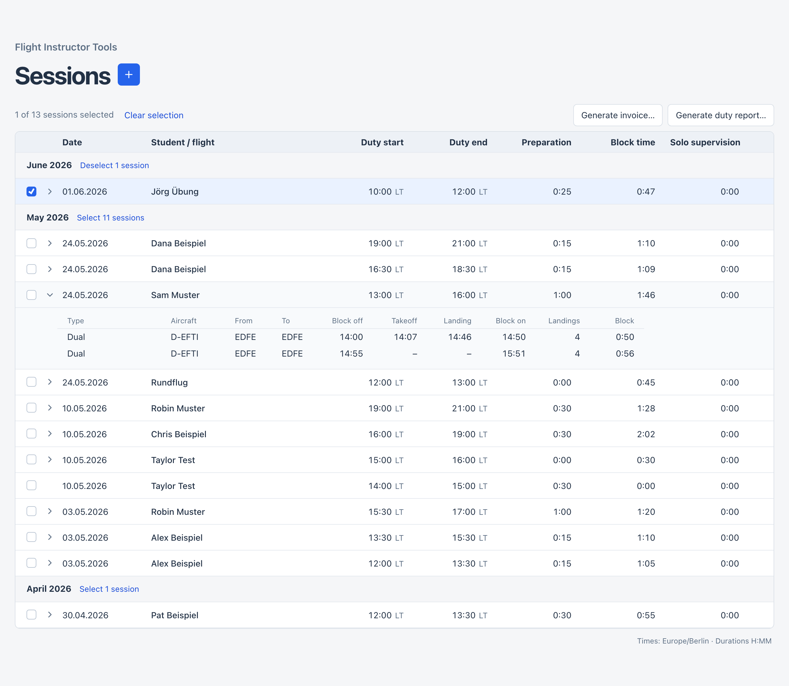

# Flight Instructor Tools

A local session manager and Go CLI for my work as a flight instructor. Session
records and billing configuration drive monthly invoice and duty report PDFs.

[](sessions-screenshot.png)

## Getting started

Requires Go 1.26.5+, Node.js 24.11+ on the 24.x line (see
[`web/package.json`](web/package.json) for other supported versions),
[pnpm](https://pnpm.io/installation), and Make. PDF generation requires
[WeasyPrint](https://doc.courtbouillon.org/weasyprint/stable/first_steps.html) on `PATH`.

```sh
make build
./fitools --sessions examples/sessions.json --config examples/config.json
```

This opens the session UI with the [example data](examples/) in your browser.
Adding or deleting a session writes to the file selected by `--sessions`,
including the example file when using the command above. Press Ctrl+C in the
terminal to stop the server.

To use your own data, run `make install` and put Go's binary directory
(`~/go/bin` by default) on your `PATH`. Keep `sessions.json` and `config.json`
in a folder outside the repository, starting from the
[example config](examples/config.json), and run `fitools` from there. Template
and signature paths in the config are relative to the config file.

## Usage

Select sessions and click **Generate invoice…** above the table to open the
invoice form. Enter an invoice number, confirm the issue date (which defaults to
today in the configured timezone), and click **Download PDF**. The invoice uses
the configured billing details and rates and includes only the selected
sessions. No invoice artifacts are kept on the server; invoice numbers and
billing status are not tracked. Invoice output is tailored to EUR, German
formatting, and 0% VAT; review generated documents before use.

**Generate duty report…** works the same way and needs `dutyReportTemplateFile`
in the config (see the [sample template](examples/duty-report.html.tmpl) for its
fields and helpers); `signatureFile` adds an optional PNG signature. Enter the
year-to-date flight-duty total before the report month as `H:MM` (`0:00` in
January). Reports include every session in the month, regardless of the viewer
selection. Daily flight-duty time spans the earliest duty start to the latest
duty end, including gaps.

The config's `timeZone` (an IANA name such as `Europe/Berlin`) is required.
Session dates, months, and issue dates all use it. Without a config file, the
session UI shows times in UTC.

Run `fitools <command> --help` for the CLI equivalents, including
`fitools validate` to check a sessions file.

### Session format

Sessions use `schemaVersion: 3`. Each session has a `dutyStart`, a `dutyEnd`,
and at least one activity with an `id`, a `type`, and positive integer
`minutes`:

```json
"activities": [
  { "id": "briefing-1", "type": "preparation", "minutes": 30 },
  { "id": "flight-1", "type": "dual", "minutes": 60 },
  { "id": "flight-2", "type": "soloSupervision", "minutes": 45 }
]
```

- `preparation`: briefing and preparation, billed at the preparation rate.
- `dual`, `soloSupervision`, `rundflug`, `schnupperflug`: flight block minutes,
  billed at the block rate.

`student` is optional only when the session has flights and all of them are
`rundflug` or `schnupperflug`. Duty times are independent of activity durations.

Each session becomes at most two invoice lines: one `Flugvorbereitung` line and
one block line labeled by its flight types (`Blockzeit`, `Rundflug`, or
`Schnupperflug`, joined with ` / ` when mixed), each prefixed with the student
name when present. Lines are not merged across sessions.

## Development

After `make build`, start development mode:

```sh
make dev
```

Open `http://127.0.0.1:5173` for the UI with React hot reload; the tab
reconnects when you restart. Go uses port 8080 and `examples/config.json`, and
writes session changes to `.dev-sessions.json`, an ignored copy of
`examples/sessions.json` that is reset on every start. Restart after Go changes.

Run checks and tests:

```sh
pnpm --dir web run check   # Formatting, linting, and TypeScript checks
pnpm --dir web exec playwright install chromium  # Once, for frontend tests
pnpm --dir web test
go test ./...
```

## License

[MIT](LICENSE.md).
