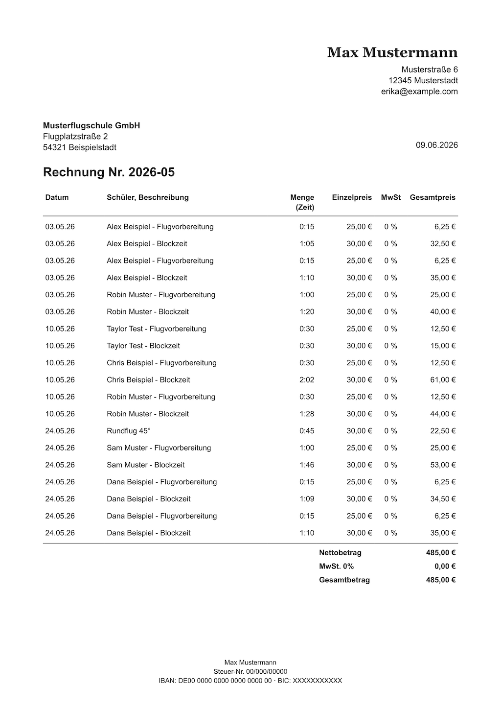

# Flight Instructor Tools

A Go CLI that automates monthly invoicing and duty reports for my work as a flight instructor.

I built this to replace manual calculations and document preparation with a reproducible workflow. Session records and billing configuration serve as a single source of truth
for JSON snapshots, HTML invoices, and PDF documents.

## Features

- Calculates preparation and block-time charges.
- Applies billing rates based on their effective dates.
- Generates invoices for a given month from HTML templates, with PDF conversion through WeasyPrint.
- Generates separate monthly duty reports using a private HTML template and an explicit reporting timezone.

<a href="invoice-screenshot.png">
    
</a>

## Getting Started

Requires Go 1.26.5 or newer and [WeasyPrint](https://doc.courtbouillon.org/weasyprint/stable/first_steps.html) available on `PATH`.

### Example

From the repository root, using the anonymized example data:

```sh
go run . generate \
    --input examples/realistic-sessions.json \
    --config examples/realistic-config.json \
    --month 2026-05 \
    --number 2026-05 \
    --issue-date 2026-06-09
```

Writes `Rechnung-2026-05.json`, `Rechnung-2026-05.html` and `Rechnung-2026-05.pdf` to `output/`.
Session files use schema version 2 with typed activities (`preparation`, `dual`, and `soloSupervision`). See [examples](examples/#session-format) for input details, version-1 migration instructions, and expected results. Keep private data and signature images in `local/`, which is ignored by Git.

### Validate sessions

Check a sessions file without generating invoice artifacts (WeasyPrint is not needed):

```sh
go run . validate examples/realistic-sessions.json
```

Returns a nonzero exit status if the file cannot be read or fails validation.

### Generate usage

| Flag                      | Purpose                           | Default            |
| ------------------------- | --------------------------------- | ------------------ |
| `--input FILE`            | Sessions file (JSON)              | Required           |
| `--config FILE`           | Billing configuration file (JSON) | Required           |
| `--month YYYY-MM`         | Billing month                     | Required           |
| `--number NUMBER`         | Invoice number                    | Required           |
| `--issue-date YYYY-MM-DD` | Invoice date of issue             | Today (local time) |
| `--output-dir DIR`        | Output directory                  | `output/`          |
| `--force`, `-f`           | Overwrite without confirmation    | `false`            |

If any output file already exists, generation asks once for confirmation to overwrite the invoice's output files. Only `y` (case-insensitive, with surrounding whitespace ignored) confirms; any other response or no input aborts without changing or creating invoice files. Use `--force` (or `-f`) to skip confirmation, including in scripts.

### Billing configuration

The `--config` JSON file contains issuer and customer details, bank and tax information, invoice text, and hourly rates with effective dates. See the [example configuration](examples/realistic-config.json).

Optional `signatureFile` adds a PNG signature; relative paths resolve from the config file's directory.

### Monthly duty reports

Duty reports are a separate command; they do not require an invoice number or alter billing:

```sh
go run . duty-report \
    --input local/sessions.json \
    --config local/config.json \
    --month 2026-05 \
    --carry-over-flight-duty 120:00
```

Writes `Dienstzeitnachweis-2026-05.json`, `.html`, and `.pdf` to `output/`. Uses the same `--output-dir`, `--force` / `-f`, and once-per-report overwrite confirmation as invoices. Optional `--issue-date YYYY-MM-DD` defaults to today in the reporting timezone.

Add these settings to the existing config:

```json
"dutyReportTemplateFile": "flight_duty_report.html.tmpl",
"timeZone": "Europe/Berlin",
"signatureFile": "signature.png"
```

`dutyReportTemplateFile` and an explicit IANA `timeZone` are required **only for duty reports**. There is no computer-timezone fallback; `Local` is rejected. Template and signature paths resolve from the config file's directory (absolute paths also work). A configured signature is automatically embedded; a missing, unreadable, or invalid PNG fails generation. Without `signatureFile`, the report is unsigned. Keep templates, configuration, sessions, signatures, and private verification output in ignored `local/`; the school's form is intentionally not distributed.

`--carry-over-flight-duty H:MM` is required, including `0:00` in January. Hours may exceed 24; minutes must be two digits from `00` to `59`. It is year-to-date flight-duty time **before** the requested month. Year total = this input + the current month's total, regardless of which other months are in the sessions file. There are no working-time or block-time carry-over inputs.

For each local day, working time and flight-duty time are the elapsed span from earliest duty start to latest duty end, including gaps. Personal block time includes only `dual` activities. Solo supervision contributes its duty interval, but not personal block time; invoicing still bills both flying activity types. Overlaps are allowed, and block time is neither capped nor deduplicated. Required rest-until is duty end plus 12 elapsed hours, shown with a local date and time. Neutral time and rest-time cells stay blank.

Reports always contain 31 row slots. Non-working days have blank time cells; nonexistent dates have blank rows. Empty requested months (including an empty schema-version-2 sessions file) produce an empty report. Sessions crossing local midnight in or into the requested month fail with the session ID; this restriction does not apply to invoices. Invoice month selection still rejects empty months.

These calculations automate a reporting practice, not legal compliance. They do not certify limits, infer breaks, or include outside-school activity. Historical activities migrated from the old schema were classified as `dual`; correct solo-supervision classifications manually if needed. Review reports before use.

#### Private duty-report template

Use Go `html/template` syntax. The template receives these fields; it may omit any of them, and unsupported field references produce an error during rendering:

- `IssueDate` (time), `Month` (`YYYY-MM`), `TimeZone`, `Issuer` (the configured party).
- `Lines`: 31 calendar slots, each with `Day` (1–31), `Date` (`YYYY-MM-DD`, empty for nonexistent dates), `Start`, `End`, `DutyOffUntil` (local times, zero on non-working days), `DutyMinutes` (both working and flight-duty minutes), and `BlockMinutes` (personal block minutes).
- `Totals`: `CurrentMonth`, `CarryOver`, `CurrentYear` (flight-duty minutes), and `BlockMinutes` (current month only). The current month's working-time total also equals `CurrentMonth`; working/block carry-over and year cells should remain blank.
- `SignatureBase64`: PNG image data, empty when no signature is configured. Embed as ``, guarded by `{{if .SignatureBase64}}`.

Helpers: `formatDuration` (minutes to `H:MM`), `formatTime` (`HH:MM`, blank for zero), `formatRestUntil` (`DD.MM.YYYY HH:MM`, blank for zero), and `formatLongDate` (`DD.MM.YYYY`). Guard durations with `{{if not .Start.IsZero}}` so non-working days stay blank. Iterate with `{{range .Lines}}`; use `{{if .Date}}{{printf "%02d." .Day}}{{end}}` for calendar labels. The independently written [test template](testdata/duty-report.html.tmpl) is a minimal example, not the school's document.

Template parsing, rendering, and signature loading happen before output is written. Duty-report PDF conversion is staged so a renderer failure leaves existing reports intact.

### Tests

```sh
go test .
```

## Limitations

Currently this is tailored to my own workflow: EUR invoices, German formatting, and 0% VAT. Matching activities are combined within a session, but not across sessions. Review generated invoices before sending them.

## License

Licensed under the [MIT License](LICENSE.md).
